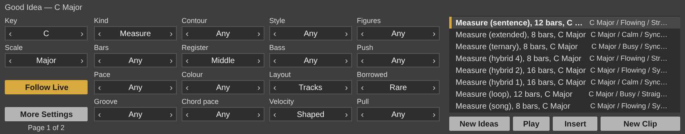
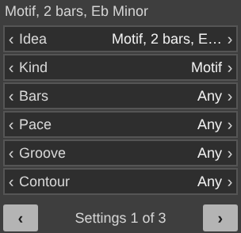

# Good Idea for Ableton Live

A Max for Live MIDI effect. The ideas come from `reascripts/gi_idea.lua` and `gi_theory.lua`, the same files the REAPER script runs, unchanged.

**Its colours are Live's**, after Ableton Live 8's default theme: neutral greys and one amber for what is on, so it sits beside Live's own devices. The REAPER version keeps the house scheme's yellow.

## Installing

Needs **Live 12.1 or later with Max for Live** (Live Suite, or Standard with
the add-on): the device runs on Max 9's JavaScript engine (`[v8ui]`).

1. Copy `Good Idea.amxd`, `GoodIdea.js` and `GoodIdea.maxpat` into one folder, for
   example `Music/Ableton/User Library/Presets/MIDI Effects/Max MIDI Effect/`. The `.amxd` finds
   `GoodIdea.js` beside it.
2. Drag `Good Idea.amxd` onto a MIDI track, in front of an instrument.
3. Optional: open it in the Max editor and click **Freeze Device**, then save.
   The device then carries the script inside it and can be moved on its own.

## Using it

| | |
| --- | --- |
| **Key, Scale** | The key it writes in. **Follow Live** keeps it on Live's scale (the Scale button in the clip view) when that scale is one ScaleView knows. |
| The middle | The engine's settings, only the ones that apply. Click the right of a value for the next, the left for the one before, or drag up and down. **Part** appears when a result has several parts: all of them, or one. |
| The list | Eight neighbouring ideas; the same number and settings always give the same idea back. Click one to hear it on the track's instrument. |
| **New Ideas** | Asks again, with a new number. |
| **Play** | Plays the chosen result again, or stops it. |
| **Insert** | Puts the chosen result where the button beside it says: **New Clip** (the first free slot on this track, from the selected scene down), **Arrangement** (at the insert marker; Live 12.2 or later) or **This Clip** (in place of the notes of the clip open in Detail View). A result with several parts puts the first on this track and each of the others on a new MIDI track beside it, named for the part. One undo step. |

The settings and the key are saved with the Live set.

## In the clip view's Generate panel

`ableton/tool/` has Good Idea as a **MIDI Tool** too: Live 12 lists it under **Generate** in a MIDI clip's view, beside Live's own. It needs Live 12.1 or later with Max for Live, as the device does.

1. Copy `Good Idea.amxd` and `GoodIdeaTool.js` from `ableton/tool/` into one folder of your User Library, for example `User Library/MIDI Tools/Max Generators/`, keeping the `.js` beside the `.amxd`.
2. Open a MIDI clip, open **Generate** in the clip view, and choose Good Idea.
3. Select the time to fill, set the panel, and click **Generate**.

| | |
| --- | --- |
| **Idea** | One of eight ideas; each click of **Generate** brings a new eight, because Live hands the tool a new seed each time. |
| The rest | The engine's settings, as on the device, six to a page: click the right of a line for the next value, the left for the one before, or drag up and down. **‹** and **›** turn the page. A change writes again at once while Live's **Auto** is on; otherwise click **Generate** again. |
| **Key**, **Scale** | Shown only when the clip has no scale. With Live's Scale on, the tool writes in the clip's key. |

The idea fills the time selection, repeated if it is shorter, and stops at its end; with no time selection it writes four bars. A Measure's parts are written together into the one clip; **Part** picks one of them. Live adds a generator’s notes to what is already in the clip, so clear the selection first to replace it.

`python3 ableton/kit/build.py ableton/tool/tool.json` builds it from the same engine, adapter and kit as the device (`ableton/kit/miditool.js`), and `node --test ableton/tests/test_tool.js` runs it on a pretend Max: the file is a MIDI Tool of its kind, wired from `live.miditool.in` to `live.miditool.out`; what it writes stays inside the time selection; the same apply gives the same notes; a changed setting asks Live to apply again; the settings are kept with the set. `node ableton/tool/window.js` redraws its picture.

## How it is built

`ableton/device.json` describes the device; `python3 ableton/kit/build.py
ableton/device.json` writes the `.amxd`, the `.maxpat` and the script bundle
`GoodIdea.js`. The bundle is Middaw's Lua 5.4 runtime, the engine, the Noterator adapter (`ableton/adapters/`) and the shared window (`ableton/kit/generator.js`). See `ableton/kit/VENDORED.md`.

`node --test ableton/tests/test_device.js` runs the device on a pretend Max and a pretend Live set: every setting stepped through, hearing a result (every note started is stopped), each way of inserting, a full track refused, following Live's scale, and saving and restoring with the set. Its own tests insert every kind of idea, a measure on one track per part. `node ableton/window.js` redraws the picture above from the device's own drawing code (it needs Playwright's Chromium).

## Limits

- The MIDI Tool has not been opened in Live either. Its file type is the one Ableton's own `maxdevtools` names; how Live hands it the notes and the context (`live.miditool.in`) comes from a working open-source tool, not from Cycling '74's reference, which could not be reached from where this was built.
- **It has not been opened in Live yet.** It is tested in Node against a stand-in for Max and the Live Object Model; nothing has run in Max. If the `.amxd` will not open, open `GoodIdea.maxpat` in Max and save it as a device.
- Results are heard on whatever instrument is after the device, a few milliseconds late at worst: Max's JavaScript runs off the audio thread.
- Parts put on new tracks have no instrument yet: a device cannot load one.
- The REAPER window's Export MIDI File and folder choices are not here: in Live, drag the clip out instead.
